```mermaid
graph TD
    subgraph Browser["Web Frontend (apps/web)"]
        UI_Chat["Chat & Thinking Panel<br/>(思維鏈、對話、審批、BranchDropdown)"]
        UI_MC["OrchestratorPanel (Mission Control)<br/>(跨對話調度、卡片摺疊、Swarm 看板)"]
        UI_Drawer["DocumentViewerDrawer (浮動文件抽屜)<br/>(Markdown 預覽、file:// 行號直開)"]
        UI_Question["Question Card<br/>(互動決策提問與選項反饋)"]
        UI_RateLimit["RateLimit & AntigravityQuotaPool<br/>(429 診斷與即時配額池監控)"]
        UI_Subagent["Subagent Panel<br/>(多代理人結構化報告與即時監控)"]
        UI_Editor["Monaco Editor & Diff<br/>(程式碼檢視與差異比對)"]
        UI_Tree["File Explorer<br/>(專案目錄樹與即時診斷)"]
        UI_Term["Xterm.js Terminal<br/>(即時指令輸出)"]
        UI_MCP["MCP & ProviderModal<br/>(工具伺服器與動態供應商管理)"]
    end

    subgraph Server["Backend Server (apps/server)"]
        WS_Gateway["WebSocket Gateway<br/>(多會話路由、提問推播、事件排程)"]
        Router_Mod["Modular Routers & DoS Guard<br/>(Auth, DB, MCP, Models, Plugins, Git Branches, Quota)"]
        DB_Service["SQLite Encrypted Vault<br/>(AES-256-GCM 憑證、runInTransaction)"]
        FS_Service["Workspace FS & Security<br/>(檔案讀寫、workspaceSecurity 白名單)"]
        PTY_Service["Terminal PTY Service<br/>(跨平台偽終端行程)"]
    end

    subgraph AgentCore["Agent Core Engine (packages/agent-core)"]
        Session_Tasks["Multi-Session Task Manager<br/>(對話隔離與背景並行排程)"]
        State_Machine["Task State Machine<br/>(code/ask 雙模式、思考、工具調用、自癒閉環)"]
        Plugin_Mgr["WorkflowPluginManager<br/>(ToolGuard 等 7 大生命週期插件)"]
        Subagent_Mgr["Subagent Orchestrator<br/>(Researcher, Coder, Reviewer, Fork, Worktree)"]
        Swarm_Sched["Scheduler & SwarmBoard<br/>(Cron/Timer 反應式排程、同儕協作看板)"]
        Harness_Exp["Harness & ExperienceManager<br/>(動態意圖裁剪、經驗提煉、ContrastiveProbe)"]
        ACP_Bridge["HarniAcpMcpBridge (In-Process MCP)<br/>(Antigravity ACP 工具橋接伺服器)"]
        Auto_Tester["Auto Test Runner<br/>(技術棧探測、堆疊擷取、自癒閉環)"]
        Syntax_Linter["Syntax & Linter Service<br/>(TS AST 極速解析、JSON、ESLint)"]
        Git_Checkpoint["Git Checkpoint Service<br/>(影子快照、Worktree 隔離、自動合併)"]
        MCP_Client["MCP Client / Manager<br/>(JSON-RPC 2.0 stdio 協定)"]
        Rate_Limiter["Rate Limit Parser<br/>(TPM/RPM/429 診斷與等待時間計算)"]
        Context_Mgr["Context Window Manager<br/>(5 層提示詞、Token 防爆截斷)"]
        Tool_Runner["Tool Registry<br/>(write_file / edit_file / run_command / ask_question)"]
        LLM_Adapter["Multi-Provider Adapters<br/>(Antigravity ACP/Direct, Claude, OpenAI, Custom)"]
    end

    UI_Chat <-->|WebSocket| WS_Gateway
    UI_MC <-->|WebSocket| WS_Gateway
    UI_Drawer <-->|WebSocket| WS_Gateway
    UI_Question <-->|WebSocket| WS_Gateway
    UI_RateLimit <-->|WebSocket| WS_Gateway
    UI_Subagent <-->|WebSocket| WS_Gateway
    UI_Editor <-->|WebSocket| WS_Gateway
    UI_Tree <-->|WebSocket| WS_Gateway
    UI_Term <-->|WebSocket| WS_Gateway
    UI_MCP <-->|REST API| Router_Mod

    WS_Gateway <--> Session_Tasks
    Session_Tasks --> State_Machine
    Router_Mod <--> DB_Service
    WS_Gateway <--> FS_Service
    WS_Gateway <--> PTY_Service

    State_Machine --> Plugin_Mgr
    State_Machine --> Subagent_Mgr
    State_Machine --> Swarm_Sched
    State_Machine --> Harness_Exp
    State_Machine --> ACP_Bridge
    State_Machine --> Auto_Tester
    State_Machine --> Syntax_Linter
    State_Machine --> Git_Checkpoint
    State_Machine --> MCP_Client
    State_Machine --> Rate_Limiter
    State_Machine --> Context_Mgr
    State_Machine --> Tool_Runner
    State_Machine --> LLM_Adapter
```

# Harni

[](https://opensource.org/licenses/MIT)
[](https://www.typescriptlang.org/)
[](https://nodejs.org/)
[](https://pnpm.io/)
[](CONTRIBUTING.md)

> **純網頁版自主 Coding Agent 開發平台 (Web-based Autonomous Coding Agent IDE)**  
> 獨立封裝自主編程核心引擎，搭配瀏覽器端現代化雙欄式 IDE 介面（Monaco Editor + Monaco Diff 比對器 + Xterm.js 終端機 + Agent 思考鏈面板 + 右側浮動文件檢視器抽屜）。  
> 內建 **Mission Control 跨對話調度中心**、**階層式多代理人編排 (Multi-Agent)**、**Swarm 同儕協作看板與反應式排程**、**Workflow Plugin 生命週期管線**、**極簡雙模式 (`code`/`ask`) 唯讀護欄**、**自適應經驗學習 (`ExperienceManager`)**、**互動式決策釐清工具**、**自動測試驅動修復 (Auto Test-Driven Repair)**、**語法與 Linter 即時回饋**、**Git 快照與 Worktree 隔離沙盒**、**MCP (Model Context Protocol) 整合**、**多服務商官方 OAuth 2.0 認證 (含 Antigravity ACP/Direct 雙模式)**、**串流 DoS/OOM 防護** 與 **SQLite AES-256-GCM 加密保險箱**。

---

## 核心特色

- **純網頁跨平台 IDE 與浮動文件檢視器**：
  - 無需安裝本機 VS Code 外掛，在任何現代瀏覽器即可與自主 Coding Agent 協同開發。
  - **雙欄式 (2-Column) 專注視圖**：左側目錄樹與多對話工作區，右側全幅對話流、思考鏈手風琴、Monaco 代碼檢視、Diff 比對與 Xterm.js 終端。
  - **右側浮動文件檢視器抽屜 (`DocumentViewerDrawer`)**：支援 Markdown 原始碼與智慧預覽一鍵切換，對話訊息內 `file://` 檔案與行號超連結點擊直開並自動定位行號。
  - **多模態輸入與動態供應商市集**：對話框支援圖片與檔案拖曳/剪貼簿貼上附件；內建 `ProviderModal` 動態自訂 LLM 供應商註冊市集。
- **Mission Control 跨 Session 調度中心 (`OrchestratorPanel`)**：
  - 集中監控所有活躍對話（Sessions）與巢狀子代理人執行矩陣、待處理行動佇列（Action Queue：待回覆 `ask_question` 與工具審批）、Swarm 協作看板訊息流與排程任務狀態。
  - **高密度卡片摺疊控制**：支援**單張對話卡片摺疊/展開**（摺疊時顯示精簡 `子代理人 (N)` 摘要徽章）與頂部**一鍵全部摺疊 / 全部展開**，搭配雙欄聚焦檢視器快速預覽與跨對話跳轉。
- **階層式多代理人、Swarm 同儕協作與反應式排程**：
  - **階層式子代理人 (`invoke_subagent`)**：內建 `researcher`（唯讀研究）、`coder`（實作）、`reviewer`（審查）、`architect`（架構規劃）、`self`（完整能力繼承），並支援 `define_subagent` 動態定義專屬角色與 `manage_subagents` 生命週期管理（`list` / `kill` / `kill_all`）。
  - **Context Fork (`fork`) 與 Worktree 自動合併**：支援 `fork` 繼承父代理人或指定成員的完整對話上下文；支援 Git Worktree 隔離沙盒與完成後自動合併 (`autoMergeWorktree`)，並具備深度防護 (Depth Guard)、Token 預算與逾時熔斷機制。
  - **Swarm 同儕協作看板 (`swarm`)**：支援任務分片 (`tasks`)、同質多副本 (`n`)、公開看板 `@mention` 廣播與 `send_message` 點對點協作。
  - **反應式排程與計時器 (`schedule`)**：支援單次倒數計時 (`durationSeconds`) 與 5 欄位 Cron 週期排程 (`cronExpression`)，無需輪詢即可透過 `[SYSTEM_NOTIFICATION]` 自動喚醒主控代理人。
  - **結構化報告解析 (`SubagentPanel`)**：前端自動將子代理人最終報告解析為 `Summary`、`Key Findings`、`Verification`、`Open Questions` 等結構化分段並即時串流進度。
- **Workflow Plugin 模組化管線與極簡雙模式 (`code` / `ask`)**：
  - **7 大內建生命週期插件 (`WorkflowPluginManager`)**：內建 `ToolGuardPlugin`（模式安全護欄）、`GitWorkspacePlugin`（Git/Worktree 注入）、`RulesAndSkillsPlugin`（規則與技能推薦）、`ExperienceLearningPlugin`（自適應經驗學習）、`SyntaxDiagnosticsPlugin`（語法與 Linter 診斷）、`AutoTestRepairPlugin`（自動測試修復）與 `RateLimitPlugin`（頻率限制診斷），支援透過 `/api/plugins` 與前端介面熱插拔啟停。
  - **極簡雙模式 (`code` / `ask`)**：收斂為 `code`（全功能自主開發）與 `ask`（架構諮詢與唯讀探索）雙模式；由 `ToolGuardPlugin` 在 `ask` 模式下強制攔截檔案寫入與終端機副作用工具，確保探索安全無虞。
- **動態意圖裁剪、自適應經驗學習與對比式探測 (`contrastive_probe`)**：
  - **動態工具集裁剪 (`DynamicSubagentHarness`)**：依子代理人角色與任務意圖動態裁剪可用工具集與系統提示詞，降低 Token 消耗並提升工具調用精準度。
  - **自適應經驗學習 (`ExperienceManager`)**：從成功完成的任務中自動提煉可重用的結構化經驗卡片（Workflow / Pitfall / Pattern），持久化至 SQLite 並在後續相似任務中智慧注入。
  - **對比式探測 (`ContrastiveProbeRunner`)**：透過 `contrastive_probe` 工具支援多候選方案平行探測、差異比較與仲裁評估。
- **版本控制：Git 影子檢查點、Worktree 隔離與分支快速管理**：
  - **自動影子快照 (`GitCheckpointService` / Shadow Commit & Stash)**：Agent 修改代碼前自動建立 `refs/harni/checkpoints/<id>` 快照，乾淨與未暫存骯髒工作區均受完整備份保護。
  - **一鍵無損還原 (One-Click Revert)**：頂部常駐「還原到本次任務前 (Rollback)」按鈕，一鍵還原 commit、物理清理任務期間新增的 untracked 檔案並恢復使用者的 stash。
  - **Git Worktree 隔離沙盒與 CLI Skill**：在 `.harni-worktrees/<sessionId>` 建立獨立分支進行探索，透過 Windows NTFS Junction / POSIX Symlink 共用 `node_modules` 零額外磁碟開銷；同時提供獨立 `.agents/skills/git-checkpoint-worktree` CLI Skill。
  - **Git 分支快速選擇器 (`BranchDropdown`)**：對話輸入列內建分支下拉選單（串接 `/api/git/branches`），支援即時搜尋、一鍵切換分支與直接建立新分支。
  - **生命週期修剪**：自動依 `maxRetained` 修剪過期快照，定期清理無效的 `harni/task-*` 孤兒分支。
- **互動式提問與決策釐清 (`ask_question` & `QuestionCard`)**：
  - 當架構方向分歧或需求模糊時，Agent 主動調用 `ask_question` 工具發起結構化選項提問卡片。
  - 前端以 `QuestionCard` 渲染題目背景、單選/多選選項切換與自訂補充文字框，使用者確認後無縫恢復 Agent 自主編程。
- **自動測試驅動修復 (Auto Test-Driven Repair / Self-Correction)**：
  - Agent 在修改代碼後，系統自動於背景觸發單元測試（智慧探測 `pnpm test`, `npm test`, `pytest`, `cargo test`, `go test` 或自訂指令）。
  - **自癒閉環**：若測試失敗，系統精準擷取錯誤堆疊 (Error Stacktrace) 並自動注入為下一輪 Observation，讓 Agent 自主修復直到測試全數通過才通知使用者（具備熔斷保護）。
- **工具命名標準化與語法 / Linter 即時回饋**：
  - 全面標準化核心工具命名（`read_file`, `write_file`, `edit_file`, `list_files`, `search_files`, `run_command`）。
  - Agent 執行 `write_file` 或 `edit_file` 後，後端自動調用 TypeScript Compiler AST 記憶體內極速解析（< 5ms）與 ESLint；若有語法或規則錯誤，行號、欄號、錯誤碼與修復指引即時附加於 `ToolResult` 尾端，促使模型在下個 Turn 立即修正。
- **智慧頻率限制診斷 (Rate Limit Diagnostics)**：
  - 精確解析 TPM (Tokens per minute)、RPM (Requests per minute)、RPD、Rolling Window 等 429 錯誤特徵。
  - 前端以 `RateLimitCard` 呈現友善倒數指示與模型切換建議，取代冰冷錯誤堆疊。
- **Model Context Protocol (MCP) 完整整合**：
  - 支援 JSON-RPC 2.0 over stdio 標準協定，無縫串接外部 MCP 工具與資源伺服器。
  - 提供前端視覺化 MCP 管理面板、精選市集（GitHub, PostgreSQL, Playwright, Codebase Memory 等）與設定熱重載（Hot-Reload）。
- **多對話背景持續執行與狀態隔離 (Multi-Session Isolation)**：
  - 各對話任務由獨立的狀態機與背景佇列處理，切換對話或新增任務不中斷運算。
  - 側邊欄與 Mission Control 即時呈現各對話的動態狀態徽章（推理中、生成中、執行中、待審批、測試中）。
- **Context Window 管理與 5 層系統提示詞架構**：
  - 智慧過濾二進位檔案，自動套用 `.gitignore`，檔案讀取與全文搜尋自動超長截斷保護。
  - 內建 5 層模組化 System Prompt 組裝管線（核心身份、工具規範、專案規則 `.harnirules`、記憶庫與動態經驗卡片）與 4 級 Context Window 解析體系，精準適配 Gemini、Claude、OpenAI 等主流旗艦模型。
- **主流服務商官方 OAuth 2.0、Antigravity ACP / Direct 雙模式與配額池監控**：
  - **Google Antigravity / Gemini**：支援官方 OAuth 授權或 API 認證，提供 **ACP 模式 (`agy acp` + In-Process Streamable HTTP MCP Bridge `HarniAcpMcpBridge`)** 與 **Direct API 模式**雙執行引擎，並內建 **Antigravity 即時配額池監控 (`AntigravityQuotaService` / `AntigravityQuotaPool`)**，即時檢視各模型剩餘額度百分比與重置倒數。
  - **Anthropic Claude (Pro / Max)**：Claude Code 相容 PKCE 授權，直接使用訂閱額度驅動 Claude 系列模型。
  - **OpenAI (Plus / Pro)**：Codex 相容 PKCE 授權，使用 ChatGPT 方案內含額度。
- **縱深防禦與企業級安全**：
  - **串流 DoS/OOM 防護**：HTTP 伺服端即時計數資料流，超出 10MB 硬上限立即熔斷並回傳 413 Payload Too Large。
  - **SQLite AES-256-GCM 加密保險箱與交易原子性**：API 金鑰與 OAuth Token 全數由後端 `SecurityService` 透過 PBKDF2/Scrypt 與 AES-256-GCM 加密存入本地 SQLite (`~/.harni/harni.db`)，並透過 `runInTransaction` 確保批次寫入交易原子性。
  - **路徑與工作區邊界防護**：內建 `pathSecurity.ts` 懸空符號連結 (Dangling Symlink) 與目錄穿越防禦、`workspaceSecurity.ts` 工作區白名單驗證、前端 `safeUrlTransform` / `redactUrlToken` 敏感權杖遮罩與 Electron `openExternal` 協定白名單。
- **Agent Skills 專業技能系統**：
  - 內建 15+ 款常用 SOP 技能（包含 `memory-bank`, `git-checkpoint-worktree`, `git-commit-from-memory`, `grill-me`, `code_review` 等），支援前端技能選單一鍵填入與工作區 `.skills/*.md` / `.agents/skills/*/SKILL.md` 自動載入。

---

## 系統架構 (Monorepo)

專案採用 **pnpm Monorepo** 全 TypeScript 嚴格模式架構：

```
harni/
├── packages/
│   ├── types/               # 前後端共用 TypeScript 型別合約、WebSocket 事件、Swarm/Schedule/Plugin/Quota 型別
│   └── agent-core/          # 獨立 Coding Agent 核心引擎 (狀態機, Subagents, Swarm, Scheduler, Plugins, Harness, Experience, ACP Bridge, AutoTest, Linter, Git, MCP)
└── apps/
    ├── server/              # Node.js HTTP (DoS防護) + WebSocket + PTY 終端 + SQLite 加密保險箱 + 配額與分支路由
    ├── web/                 # React 19 + Vite + TailwindCSS + Monaco + Xterm.js + Mission Control + 浮動文件抽屜
    └── desktop/             # Electron 37 桌面端整合應用 (共用 ~/.harni/harni.db 與安全協定白名單)
```



---

## 快速開始 (Quick Start)

### 1. 環境需求
- **Node.js** >= 20.0.0
- **pnpm** >= 9.0.0（推薦使用專案鎖定之 `pnpm@12.18.0`）
- **C/C++ 建置工具**（供原生終端模組 `node-pty` 編譯使用）：
  - **Windows**：Visual Studio Build Tools (包含 C++ 套件) 或 Python
  - **Linux / macOS**：`gcc` / `g++` / `make` / `python3`

### 2. 安裝與設定
```bash
# 複製專案
git clone https://github.com/jerrymds/Harni.git
cd Harni

# 複製環境變數設定（可選，預設已配置為本機安全模式）
cp .env.example .env

# 安裝所有相依套件
pnpm install
```

### 3. 啟動開發伺服器
一鍵啟動後端伺服器 (Port 3001) 與前端 Web 介面 (Port 3000)：
```bash
pnpm dev
```

開啟瀏覽器造訪 **`http://localhost:3000`**，即可開始體驗專屬 Coding Agent IDE！

> [!TIP]
> **生產環境建置與桌面版打包 (Production Build & Desktop Packaging)**：
> ```bash
> # 建置所有套件與前後端生產環境產物
> pnpm build
>
> # 一鍵打包 Electron 跨平台桌面應用程式 (apps/desktop)
> pnpm package:desktop
> ```

---

## 安全性須知 (Security Notice)

> [!CAUTION]
> Harni 具備終端指令執行 (PTY) 與本機檔案系統讀寫權限。
> - **本機隔離**：預設僅監聽 `127.0.0.1`，僅供本機開發者存取。
> - **公開網路防護**：若需對區域網路或公網開放（`HOST=0.0.0.0`），**系統強制要求在 `.env` 中設定強密碼 `AUTH_TOKEN`**，以嚴格防止未授權的遠端代碼執行 (RCE)。
> - 完整安全政策請參閱 [SECURITY.md](SECURITY.md)。

---

## 模型配置與服務商認證

### 使用 Google Antigravity (OAuth / ACP & Direct 雙執行模式 / 配額池監控)
1. 設定 -> 模型，服務商選擇 **Google Antigravity**。
2. 支援透過 Google OAuth 官方帳號授權登入，並可自由切換兩種執行引擎模式：
   - **ACP 模式 (`agy acp`)**：透過本機 Antigravity CLI 搭配內建 `HarniAcpMcpBridge` (In-Process Streamable HTTP MCP Bridge)，無縫橋接 Harni 原生工具集、Mission Control 與子代理人調度。
   - **Direct API 模式**：由 Harni Agent Core 狀態機直接驅動 Antigravity 模型端點。
3. **即時配額池監控 (`AntigravityQuotaPool`)**：設定面板與狀態列即時顯示各模型群組的剩餘配額百分比與重置時間倒數。

### 使用 Claude 訂閱登入 (Pro / Max)
1. 設定 -> 模型，服務商選擇 **Anthropic Claude**。
2. 點擊「**使用 Claude 登入**」，新分頁開啟 `claude.ai` 授權頁。
3. 同意授權後 claude.ai 會顯示一段 `code#state` 授權碼，**複製整段**貼回設定頁的輸入框，按「完成登入」。
4. `sk-ant-oat…` 權杖以 **AES-256-GCM 加密存入本地 SQLite**（`anthropic-oauth` 槽），到期自動續期。模型清單切換為訂閱可用的 Claude 系列。

### 使用 OpenAI 訂閱登入 (Plus / Pro)
1. 設定 -> 模型，服務商選擇 **OpenAI GPT**。
2. 點擊「**使用 OpenAI 登入**」，在 OpenAI 官方頁面完成 ChatGPT 帳號授權。
3. 授權頁會回到本機 `localhost:1455` 完成 PKCE 登入；請確保該連接埠未被占用。
4. 登入後會切換為訂閱可用的 Codex 模型。若另行儲存 OpenAI API Key，直接 API Key 優先。

### 使用其他 Provider 與動態供應商市集 (`ProviderModal`)
在設定頁面可選擇內建服務商（如 Cline API, Ollama, OpenRouter, DeepSeek 等），或透過 **動態供應商市集 (`ProviderModal`)** 註冊任意 OpenAI / Anthropic 相容的自訂網關（輸入自訂名稱、API Key、Base URL 與模型清單即可動態掛載）。

---

## 執行自動化測試

專案使用 **Vitest** 構建完整的多層級測試體系：

```bash
# 執行全專案自動化測試
pnpm test

# 單獨測試 Agent Core 引擎 (包含狀態機、多代理人編排、Swarm、排程、Plugins、自癒測試、語法 Linter、MCP、Git 快照等)
pnpm test:core

# 單獨測試後端伺服器 (包含 WebSocket 協定、多對話隔離、SQLite、PTY、DoS 串流防護等)
pnpm test:server

# 單獨測試前端 React 元件與 Zustand Store (包含 OrchestratorPanel、DocumentViewerDrawer、QuestionCard、RateLimitCard、SubagentPanel 等)
pnpm test:web

# 產出全專案測試覆蓋率報告
pnpm test:coverage

# 型別檢查與程式碼風格驗證
pnpm typecheck
pnpm lint
```

---

## 套件結構說明

| 套件路徑 | 說明 |
| :--- | :--- |
| **`packages/types`** (`@harni/types`) | 前後端共用 TypeScript 型別合約、WebSocket 事件協定 (`ServerToClientEvents`, `ClientToServerEvents`)、Subagent、Swarm、Schedule、WorkflowPlugin、AntigravityQuota、Diagnostics、QuestionPrompt、RateLimitInfo 與 AutoTest 型別 |
| **`packages/agent-core`** (`@harni/agent-core`) | 獨立 Coding Agent 核心引擎：<br/>• `engine.ts`：多對話任務狀態機、`code`/`ask` 雙模式、自癒閉環與提問掛起<br/>• `plugins/`：`WorkflowPluginManager` 與 `ToolGuardPlugin` 等 7 大內建生命週期插件<br/>• `subagents/`：階層式多代理人管理器、Context Fork 與生命週期調度<br/>• `harness/`：`DynamicSubagentHarness` 動態意圖裁剪、`ExperienceManager` 自適應經驗學習與 `ContrastiveProbeRunner` 對比式探測<br/>• `scheduler/` & `swarm/`：`SchedulerService` 反應式 Cron/Timer 排程與 `SwarmBoardService` 同儕協作看板<br/>• `mcp/`：JSON-RPC 2.0 stdio MCP Client 與 Manager<br/>• `providers/`：`HarniAcpMcpBridge` (In-Process Streamable HTTP MCP Bridge) 與多服務商適配器（Antigravity ACP/Direct、Claude、OpenAI 與自訂網關）<br/>• `testing/`：`AutoTestRunner` 跨技術棧測試探測與堆疊擷取<br/>• `diagnostics/`：`SyntaxLinterService` TypeScript AST 極速語法與 Linter 解析<br/>• `git/`：`GitCheckpointService` 影子快照、Worktree 隔離、自動合併與生命週期修剪<br/>• `tools/`：標準化內建工具集（`read_file`, `write_file`, `edit_file`, `list_files`, `search_files`, `run_command`, `ask_question`, `invoke_subagent`, `swarm`, `schedule`, `contrastive_probe` 等）<br/>• `utils/`：`pathSecurity.ts` 懸空符號連結防禦與 `rateLimit.ts` TPM/RPM 頻率限制智慧解析器 |
| **`apps/server`** (`@harni/server`) | Node.js HTTP + WebSocket + `node-pty` 伺服器、SQLite AES-256-GCM 加密保險箱（支援 `runInTransaction` 交易原子性）、`workspaceSecurity.ts` 工作區白名單防護、`AntigravityQuotaService` 配額監控、模組化 Router（含 `/api/plugins`, `/api/git/branches` 等）與 DoS 串流防護 |
| **`apps/web`** (`@harni/web`) | React 19 + Vite + TailwindCSS 網頁端 IDE，整合 Monaco 編輯器、Diff Viewer、Xterm.js、`OrchestratorPanel` (Mission Control)、`DocumentViewerDrawer` (浮動文件檢視器)、`BranchDropdown`、`AntigravityQuotaPool`、`ProviderModal`、`SubagentPanel`、`QuestionCard`、`RateLimitCard` 與 MCP 管理面板 |
| **`apps/desktop`** (`@harni/desktop`) | Electron 37 跨平台桌面應用程式殼層，支援 `pnpm package:desktop` 一鍵打包、與 Web/Server 共用本地 SQLite 資料庫 (`~/.harni/harni.db`) 及 `openExternal` 安全協定白名單防護 |

---

## 社群參與與安全 (Community & Security)

歡迎提交 Issue、建議或 Pull Request 共同完善 Harni！
- **貢獻指引**：請詳閱 [CONTRIBUTING.md](CONTRIBUTING.md) 了解開發規範與 PR 流程。
- **安全政策**：若發現安全漏洞，請參閱 [SECURITY.md](SECURITY.md) 進行負責任的私下通報。

---

## License

本專案採用 [MIT License](LICENSE) 開源授權。
